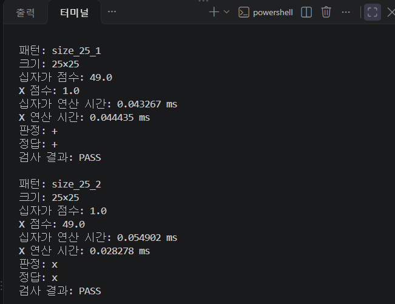
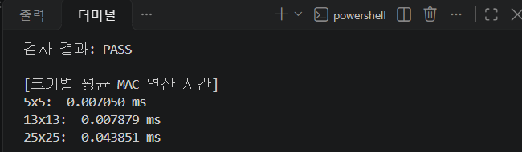
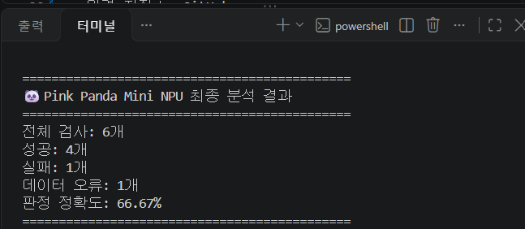
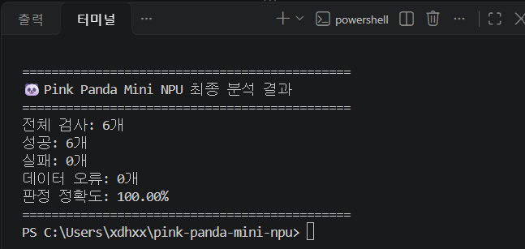
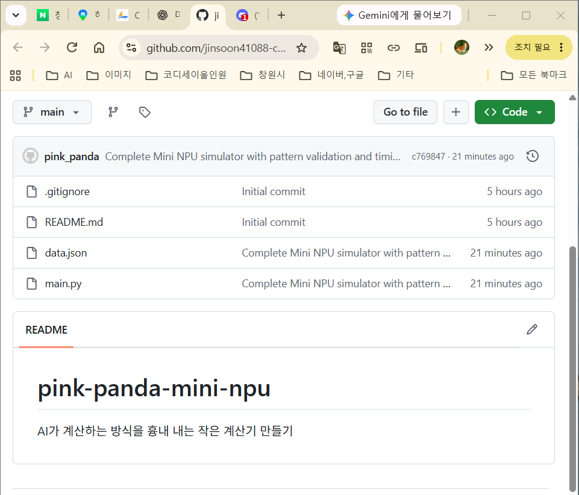

# 🐼 Pink Panda Mini NPU Simulator

## AI가 계산하는 방식을 흉내 내는 작은 계산기 만들기

### 📌 1. 프로젝트 소개

이 프로젝트는 AI가 숫자 데이터를 이용하여 그림의 모양을 판별하는 원리를 이해하기 위해 제작한 Mini NPU 시뮬레이터입니다.

Python을 이용하여 입력 패턴과 필터를 곱하고 더하는 MAC 연산을 구현하고, 십자가(+)와 X 모양을 판별하도록 제작했습니다.

### 💻 2. 개발 환경

- 운영체제: Windows 11
- 개발 언어: Python
- 개발 도구: Visual Studio Code
- 터미널: PowerShell
- 데이터 형식: JSON
- 버전 관리: Git
- 원격 저장소: GitHub

### 🎯 3. 프로젝트 학습 목표

- MAC 연산의 개념과 원리 이해
- 입력 패턴과 필터의 유사도 계산
- JSON 데이터의 키 규칙 이해
- 라벨 정규화의 필요성 이해
- 부동소수점 오차 이해
- EPSILON 허용오차 기반 판정
- 크기별 연산 시간 측정
- 시간 복잡도 O(N²) 이해
- 실패 케이스 및 데이터 오류 분석

### 🧮 4. MAC 연산이란?

MAC은 Multiply-Accumulate의 약자로,
곱셈과 누적 덧셈을 의미합니다.

입력 패턴과 필터의 같은 위치에 있는 숫자를
서로 곱한 후 모든 결과를 더하는 방식입니다.

예시:

1 × 1 + 0 × 0 + 1 × 1 = 2

AI는 이러한 계산을 반복하여 입력 데이터의
특징을 분석합니다.

### ➕ 5. 십자가와 X 패턴 판정 원리

십자가 패턴:

    0 1 0
    1 1 1
    0 1 0

X 패턴:

    1 0 1
    0 1 0
    1 0 1

입력 패턴과 십자가 필터, X 필터를 각각
MAC 연산하여 점수를 계산합니다.

- 십자가 점수가 높으면 십자가로 판정
- X 점수가 높으면 X로 판정
- 두 점수의 차이가 허용오차보다 작으면 UNDECIDED

### 📂 6. JSON 데이터 구조

data.json은 filters와 patterns로 구성됩니다.

| 패턴 이름 | 배열 크기 | 정답 |
|---|---|---|
| size_5_1 | 5×5 | + |
| size_5_2 | 5×5 | x |
| size_13_1 | 13×13 | + |
| size_13_2 | 13×13 | x |
| size_25_1 | 25×25 | + |
| size_25_2 | 25×25 | x |

키 이름의 크기 정보와 실제 배열의 크기가
일치하는지 검사합니다.

### 🔄 7. 라벨 정규화

같은 의미를 가진 여러 표현을 하나의
표준 표현으로 통일합니다.

| 입력 라벨 | 정규화 결과 |
|---|---|
| cross | + |
| CROSS | + |
| A | + |
| + | + |
| x | x |
| X | x |
| B | x |
| UNDECIDED | UNDECIDED |
| 지원하지 않는 라벨 | UNKNOWN |

라벨 정규화를 통해 표현 방식의 차이로
발생하는 잘못된 판정을 방지합니다.

### 🔢 8. 부동소수점 오차와 EPSILON

컴퓨터는 일부 소수를 정확하게 표현하지 못합니다.

예시:

    0.1 + 0.2 = 0.30000000000000004

이러한 미세한 계산 오차를 처리하기 위해
EPSILON이라는 허용오차를 사용했습니다.

    EPSILON = 1e-9

두 점수의 차이가 EPSILON보다 작으면
UNDECIDED로 판정합니다.

### ⏱️ 9. MAC 연산 시간 및 시간 복잡도

| 배열 크기 | MAC 반복 횟수(1회 연산) | 평균 연산 시간 측정 예시 |
|---|---:|---:|
| 5×5 | 25회 | 0.001715 ms |
| 13×13 | 169회 | 0.009803 ms |
| 25×25 | 625회 | 0.020944 ms |

배열의 크기가 N×N이면 모든 원소를
검사하기 위해 N²번의 반복이 필요합니다.

따라서 MAC 연산의 시간 복잡도는 O(N²)입니다.

실제 연산 시간은 컴퓨터 환경과 실행 상태에
따라 달라질 수 있습니다.

### 🔍 10. 실패 케이스 및 오류 처리

다음과 같은 오류를 검사하도록 구현했습니다.

- 배열 크기 불일치
- 잘못된 키 이름
- 숫자가 아닌 데이터
- NaN 및 Infinity
- 지원하지 않는 패턴 크기
- 지원하지 않는 정답 라벨
- 실제 판정과 정답의 불일치

데이터 자체가 잘못된 경우는 데이터 오류로,
정상 데이터의 판정이 정답과 다르면 FAIL로
구분하여 처리합니다.

### 🎮 11. 프로그램 실행 방법

터미널에서 다음 명령어를 실행합니다.

    python main.py

프로그램 실행 메뉴:

    🐼 Pink Panda Mini NPU Simulator

    1. 사용자 입력 (3×3)
    2. data.json 분석
    3. 프로그램 종료

1번은 직접 숫자 배열을 입력하는 기능입니다.

2번은 JSON 파일의 패턴을 자동으로 분석합니다.

3번은 프로그램을 종료합니다.

### 📊 12. 최종 실행 결과

    =============================================
    🐼 Pink Panda Mini NPU 최종 분석 결과
    =============================================
    전체 검사: 6개
    성공: 6개
    실패: 0개
    데이터 오류: 0개
    판정 정확도: 100.00%
    =============================================

준비한 정상 패턴 데이터 6개를 모두
올바르게 판정했습니다.

### 📁 13. 프로젝트 파일 구성

    pink-panda-mini-npu/
    ├── main.py
    ├── data.json
    ├── README.md
    └── .gitignore

- main.py: Mini NPU 프로그램 실행 코드
- data.json: 필터 및 입력 패턴 데이터
- README.md: 프로젝트 설명 및 사용 방법
- .gitignore: Git 추적 제외 파일 설정

### 📸 14. 프로그램 실행 스크린샷

#### 14-1. 프로그램 메인 메뉴

#### 14-2. 사용자 입력 및 MAC 연산

#### 14-3. 5×5 패턴 분석

#### 14-4. 13×13 패턴 분석

#### 14-5. 25×25 패턴 분석

#### 14-6. 크기별 평균 MAC 연산 시간

#### 14-7. EPSILON 허용오차 검사

#### 14-8. 잘못된 데이터 오류 처리

#### 14-9. 최종 판정 정확도 100%

#### 14-10. GitHub 업로드 결과

### 🌱 15. 미션을 통해 배운 점

이번 미션을 통해 AI가 그림을 사람처럼 직접
인식하는 것이 아니라 숫자 데이터로 변환하여
계산한다는 원리를 배웠습니다.

MAC 연산, JSON 데이터 처리, 라벨 정규화,
부동소수점 오차, 시간 복잡도의 개념을
직접 프로그램을 만들면서 학습했습니다.

코드를 작성하는 과정에서 발생한 오류를
하나씩 확인하고 해결하는 경험도 했습니다.

또한 Git과 GitHub를 이용하여 개발 과정과
완성된 프로그램을 기록하는 방법을 익혔습니다.

---

🐼 Pink Panda Mini NPU Project

포기하지 않고 한 단계씩 성장하는 개발 공부!
