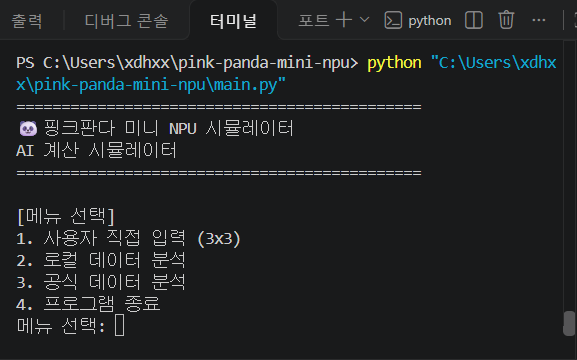
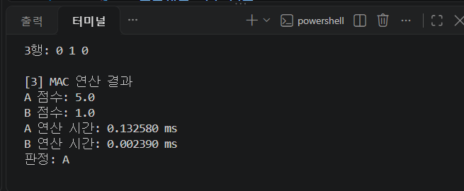
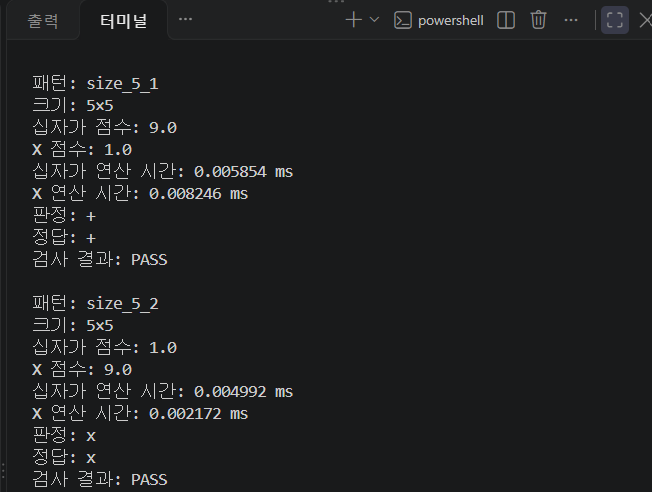
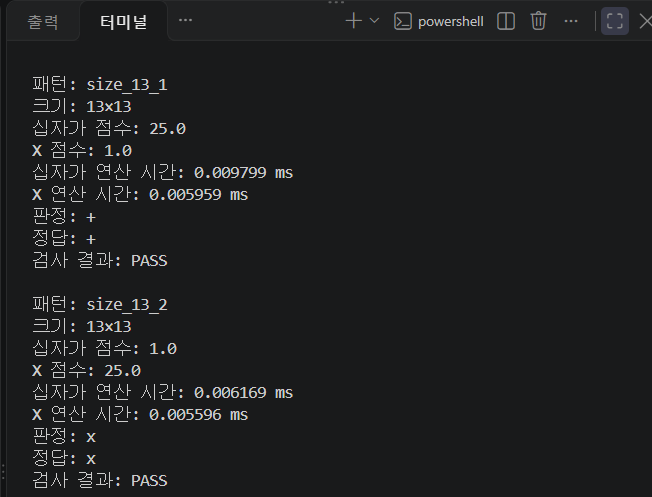
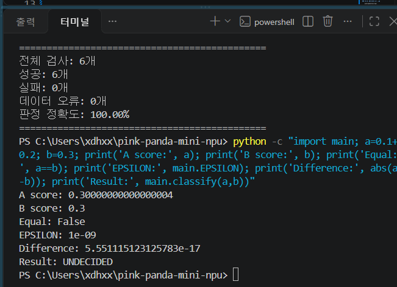
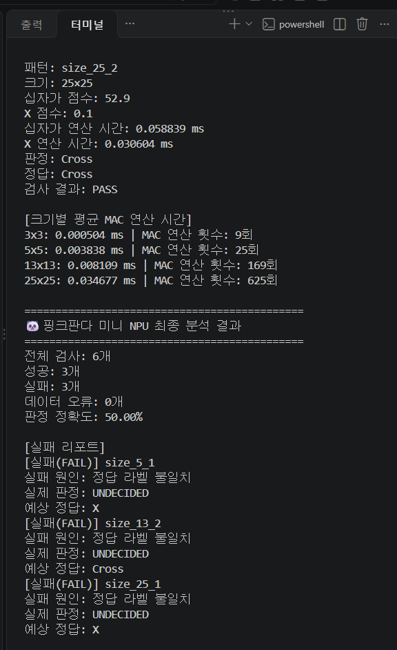

# 🐼 Pink Panda Mini NPU Simulator

## AI가 계산하는 방식을 흉내 내는 작은 계산기 만들기

---

### 📌 1. 프로젝트 소개

이 프로젝트는 AI가 숫자 데이터를 이용하여 그림의 모양을 판별하는 원리를 이해하기 위해 제작한 Mini NPU 시뮬레이터입니다.

Python을 이용하여 입력 패턴과 필터를 곱하고 더하는 MAC 연산을 구현하고, 십자가(+)와 X 모양을 판별하도록 제작했습니다.

### 💻 2. 개발 환경

- 운영체제: Windows 11
- 개발 언어: Python
- 개발 도구: Visual Studio Code
- 터미널: PowerShell
- 데이터 형식: JSON
- 버전 관리: Git
- 원격 저장소: GitHub

### 🎯 3. 프로젝트 학습 목표

- MAC 연산의 개념과 원리 이해
- 입력 패턴과 필터의 유사도 계산
- JSON 데이터의 키 규칙 이해
- 라벨 정규화의 필요성 이해
- 부동소수점 오차 이해
- EPSILON 허용오차 기반 판정
- 크기별 연산 시간 측정
- 시간 복잡도 O(N²) 이해
- 실패 케이스 및 데이터 오류 분석

### 🧮 4. MAC 연산이란?

MAC은 Multiply-Accumulate의 약자로,
곱셈과 누적 덧셈을 의미합니다.

입력 패턴과 필터의 같은 위치에 있는 숫자를
서로 곱한 후 모든 결과를 더하는 방식입니다.

예시:

1 × 1 + 0 × 0 + 1 × 1 = 2

AI는 이러한 계산을 반복하여 입력 데이터의
특징을 분석합니다.

### ➕ 5. 십자가와 X 패턴 판정 원리

십자가 패턴:

    0 1 0
    1 1 1
    0 1 0

X 패턴:

    1 0 1
    0 1 0
    1 0 1

입력 패턴과 십자가 필터, X 필터를 각각
MAC 연산하여 점수를 계산합니다.

- 십자가 점수가 높으면 십자가로 판정
- X 점수가 높으면 X로 판정
- 두 점수의 차이가 허용오차보다 작으면 UNDECIDED

### 📂 6. JSON 데이터 구조

data.json은 filters와 patterns로 구성됩니다.

| 패턴 이름 | 배열 크기 | 정답 |
|---|---|---|
| size_5_1 | 5×5 | + |
| size_5_2 | 5×5 | x |
| size_13_1 | 13×13 | + |
| size_13_2 | 13×13 | x |
| size_25_1 | 25×25 | + |
| size_25_2 | 25×25 | x |

키 이름의 크기 정보와 실제 배열의 크기가
일치하는지 검사합니다.

### 🔄 7. 라벨 정규화

같은 의미를 가진 여러 표현을 하나의
표준 표현으로 통일합니다.

| 입력 라벨 | 정규화 결과 |
|---|---|
| cross | + |
| CROSS | + |
| A | + |
| + | + |
| x | x |
| X | x |
| B | x |
| UNDECIDED | UNDECIDED |
| 지원하지 않는 라벨 | UNKNOWN |

라벨 정규화를 통해 표현 방식의 차이로
발생하는 잘못된 판정을 방지합니다.

### 🔢 8. 부동소수점 오차와 EPSILON

컴퓨터는 일부 소수를 정확하게 표현하지 못합니다.

예시:

    0.1 + 0.2 = 0.30000000000000004

이러한 미세한 계산 오차를 처리하기 위해
EPSILON이라는 허용오차를 사용했습니다.

    EPSILON = 1e-9

두 점수의 차이가 EPSILON보다 작으면
UNDECIDED로 판정합니다.

### ⏱️ 9. MAC 연산 시간 및 시간 복잡도

| 배열 크기 | MAC 반복 횟수(1회 연산) | 평균 연산 시간 측정 예시 |
|---|---:|---:|
| 3×3 | 9 | 0.000720 ms |
| 5×5 | 25 | 0.003355 ms |
| 13×13 | 169 | 0.011757 ms |
| 25×25 | 625 | 0.031468 ms |

#### ⏱️ MAC 연산 성능 측정 분석

- MAC 연산 시간 측정은 각각 1,000회 반복하여 수행합니다.
- MAC 함수가 실행되는 시간만 측정합니다.
- 평균 연산 시간은 밀리초(ms) 단위로 계산합니다.
- 3×3 크기의 행렬은 9회의 MAC 연산이 필요합니다.
- 5×5 크기의 행렬은 25회의 MAC 연산이 필요합니다.
- 13×13 크기의 행렬은 169회의 MAC 연산이 필요합니다.
- 25×25 크기의 행렬은 625회의 MAC 연산이 필요합니다.
- 이중 반복문을 사용하여 N×N개의 행렬 요소를 처리합니다.
- 따라서 MAC 연산의 시간 복잡도는 O(N²)입니다.
- 행렬의 한 변의 크기(N)가 2배 증가하면 연산 횟수는 4배 증가합니다.

배열의 크기가 N×N이면 모든 원소를
검사하기 위해 N²번의 반복이 필요합니다.

따라서 MAC 연산의 시간 복잡도는 O(N²)입니다.

실제 연산 시간은 컴퓨터 환경과 실행 상태에
따라 달라질 수 있습니다.

### 🔍 10. 실패 케이스 및 오류 처리

다음과 같은 오류를 검사하도록 구현했습니다.

- 배열 크기 불일치
- 잘못된 키 이름
- 숫자가 아닌 데이터
- NaN 및 Infinity
- 지원하지 않는 패턴 크기
- 지원하지 않는 정답 라벨
- 실제 판정과 정답의 불일치

데이터 오류와 정답 라벨 불일치는 모두 실패(FAIL)로 집계합니다.

데이터 오류는 전체 실패 횟수에 포함되며, 데이터 오류 횟수는 별도로 구분하여 표시합니다.

#### 📋 실패 리포트 처리 규칙

- 모든 데이터 오류는 실패(FAIL)로 집계합니다.
- 데이터 오류 횟수는 전체 실패 횟수에 포함됩니다.
- 전체 검사 수 = 성공(PASS) 수 + 실패(FAIL) 수입니다.
- 일부 데이터에 오류가 발생하더라도 나머지 데이터의 검사를 계속 진행합니다.
- 실패한 데이터의 식별 이름과 실패 원인을 기록합니다.
- 판정 결과가 정답과 일치하지 않으면 실제 판정 결과와 예상 정답을 함께 표시합니다.
- 데이터 오류가 발생하면 자세한 오류 메시지를 표시합니다.
- 모든 데이터가 검사를 통과하면 실패 사례 없음(No failed cases)을 표시합니다.

### 🎮 11. 프로그램 실행 방법

터미널에서 다음 명령어를 실행합니다.

    python main.py

프로그램 실행 메뉴:
### 🐼 핑크판다 미니 NPU 시뮬레이터

    1. 사용자 직접 입력 (3×3)
    2. 로컬 데이터 분석
    3. 공식 데이터 분석
    4. 프로그램 종료

#### 📋 메뉴별 기능 설명

- **메뉴 1:** 3×3 크기의 행렬을 직접 입력하고 MAC 연산을 수행하여 점수를 계산합니다.
- **메뉴 2:** 로컬 데이터 파일(data.json)을 불러와 패턴을 분석합니다.
- **메뉴 3:** 공식 데이터 파일(data-official.json)을 불러와 패턴을 분석합니다.
- **메뉴 4:** 프로그램을 종료합니다.
- 잘못된 메뉴 번호를 입력하면 오류 메시지를 표시합니다.

### 📊 12. 최종 실행 결과

    =============================================
    🐼 Pink Panda Mini NPU 최종 분석 결과
    =============================================
    전체 검사: 6개
    성공: 6개
    실패: 0개
    데이터 오류: 0개
    판정 정확도: 100.00%
    =============================================

준비한 정상 패턴 데이터 6개를 모두
올바르게 판정했습니다.

### 📁 13. 프로젝트 파일 구성

    pink-panda-mini-npu/
    ├── main.py
    ├── data.json
    ├── README.md
    └── .gitignore

- main.py: Mini NPU 프로그램 실행 코드
- data.json: 필터 및 입력 패턴 데이터
- README.md: 프로젝트 설명 및 사용 방법
- .gitignore: Git 추적 제외 파일 설정

### 📸 14. 프로그램 실행 스크린샷

#### 14-1. 프로그램 메인 메뉴

#### 14-2. 사용자 입력 및 MAC 연산

#### 14-3. 5×5 패턴 분석

#### 14-4. 13×13 패턴 분석

#### 14-5. 25×25 패턴 분석

#### 14-6. 크기별 평균 MAC 연산 시간

#### 14-7. EPSILON 허용오차 검사

#### 14-8. 잘못된 데이터 오류 처리

#### 14-9. 최종 판정 정확도 100%

#### 14-10. GitHub 업로드 결과

### 🌱 15. 미션을 통해 배운 점

이번 미션을 통해 AI가 그림을 사람처럼 직접
인식하는 것이 아니라 숫자 데이터로 변환하여
계산한다는 원리를 배웠습니다.

MAC 연산, JSON 데이터 처리, 라벨 정규화,
부동소수점 오차, 시간 복잡도의 개념을
직접 프로그램을 만들면서 학습했습니다.

코드를 작성하는 과정에서 발생한 오류를
하나씩 확인하고 해결하는 경험도 했습니다.

또한 Git과 GitHub를 이용하여 개발 과정과
완성된 프로그램을 기록하는 방법을 익혔습니다.

---

🐼 Pink Panda Mini NPU Project

포기하지 않고 한 단계씩 성장하는 개발 공부!

### 16. 결과 리포트 (Result Report)

### 16. 결과 리포트

1. 로컬 데이터의 테스트 패턴 6개가 모두 검사를 통과했습니다.
2. 정상 데이터의 판정 정확도는 100.00%입니다.
3. 정상 데이터 검사에서는 판정 실패와 데이터 오류가 발생하지 않았습니다.
4. 라벨 정규화를 통해 +는 십자가(Cross)로, 소문자 x는 대문자 X로 변환합니다.
5. 매우 작은 소수점 계산 오차를 처리하기 위해 EPSILON(허용오차)을 1e-9로 설정했습니다.
6. 오류 처리 기능을 확인하기 위해 의도적으로 2개의 실패 사례를 만들었습니다.
7. 오류 검사 결과는 성공(PASS) 4개, 실패(FAIL) 2개입니다.
8. 오류 검사의 판정 정확도는 66.67%입니다.
9. size_5_1은 예상 정답 라벨이 잘못되어 판정에 실패했습니다.
10. size_5_2는 행렬의 크기가 올바르지 않아 검사에 실패했습니다.
11. 데이터 오류도 전체 실패(FAIL) 횟수에 포함됩니다.
12. 실패 리포트에는 실패한 데이터의 식별 이름과 실패 원인을 기록합니다.
13. MAC 연산을 1,000회 반복하여 실행 시간을 측정했습니다.
14. 행렬 크기별 MAC 연산 횟수는 각각 9회, 25회, 169회, 625회입니다.
15. MAC 연산의 시간 복잡도는 O(N²)입니다.
16. 행렬의 크기가 커질수록 연산 실행 시간이 증가합니다.
17. 공식 데이터 검증을 완료했습니다.

#### 📊 추가 결과 분석

- 로컬 데이터의 패턴 6개가 모두 예상 정답과 일치했습니다.
- 라벨 정규화를 통해 서로 다른 라벨 표기 방식으로 발생하는 불일치를 방지합니다.
- EPSILON(허용오차)을 사용하여 거의 동일한 점수를 서로 다른 점수로 잘못 판단하는 것을 방지합니다.
- 정상 데이터 검사에서는 두 점수가 거의 동일한 사례가 발생하지 않았습니다.
- 행렬의 크기가 증가하면서 MAC 연산 횟수는 9회에서 625회로 증가했습니다.
- MAC 연산 횟수는 약 69.44배 증가했습니다.
- 측정된 연산 실행 시간은 약 43.71배 증가했습니다.
- 실제 실행 시간은 컴퓨터의 성능, 시스템 상태 및 시간 측정 과정에서 발생하는 부가적인 작업에 따라 달라질 수 있습니다.
- 이중 반복문을 사용하므로 N×N 크기의 행렬에서 N²번의 MAC 연산을 수행합니다.
- 공식 데이터 검증을 완료했습니다.

### 17. 공식 데이터 검증

공식 데이터는 원본 데이터의 값을 수정하지 않고 그대로 사용하여 검사했습니다.

| 데이터 종류 | 전체 검사 수 | 성공(PASS) | 실패(FAIL) | 데이터 오류 | 판정 정확도 |
|---|---:|---:|---:|---:|---:|
| 로컬 데이터 | 6개 | 6개 | 0개 | 0개 | 100.00% |
| 공식 데이터 | 6개 | 3개 | 3개 | 0개 | 50.00% |
#### 📊 공식 데이터 검사 결과

| 패턴 이름 | 실제 판정 결과 | 예상 정답 | 검사 결과 |
|---|---|---|---|
| size_5_1 | 판정 보류(UNDECIDED) | X | 실패(FAIL) |
| size_5_2 | 십자가(Cross) | 십자가(Cross) | 성공(PASS) |
| size_13_1 | X | X | 성공(PASS) |
| size_13_2 | 판정 보류(UNDECIDED) | 십자가(Cross) | 실패(FAIL) |
| size_25_1 | 판정 보류(UNDECIDED) | X | 실패(FAIL) |
| size_25_2 | 십자가(Cross) | 십자가(Cross) | 성공(PASS) |

#### ⏱️ 공식 MAC 연산 성능 측정 결과

| 행렬 크기 | MAC 연산 횟수 | 평균 연산 시간 |
|---|---:|---:|
| 3×3 | 9회 | 0.001042 ms |
| 5×5 | 25회 | 0.002625 ms |
| 13×13 | 169회 | 0.016709 ms |
| 25×25 | 625회 | 0.043371 ms |

#### 📸 검증 증거 자료

#### 📊 공식 데이터 판정 실패 원인 분석

| 패턴 이름 | 십자가 점수 | X 점수 | 실제 판정 결과 | 예상 정답 |
|---|---:|---:|---|---|
| size_5_1 | 0.9 | 0.8999999999999999 | 판정 보류(UNDECIDED) | X |
| size_13_2 | 7.499999999999997 | 7.5 | 판정 보류(UNDECIDED) | 십자가(Cross) |
| size_25_1 | 4.9 | 4.899999999999999 | 판정 보류(UNDECIDED) | X |

1. 공식 데이터에는 총 6개의 테스트 패턴이 포함되어 있습니다.
2. 검사 결과는 성공(PASS) 3개, 실패(FAIL) 3개입니다.
3. 공식 데이터의 판정 정확도는 50.00%입니다.
4. 데이터 유효성 검사에서 오류는 발생하지 않았습니다.
5. 판정에 실패한 모든 패턴은 십자가와 X의 MAC 연산 점수가 거의 동일했습니다.
6. 두 점수의 차이는 EPSILON(허용오차)인 1e-9보다 작았습니다.
7. 컴퓨터에서 부동소수점 연산을 수행할 때 매우 작은 소수점 계산 오차가 발생할 수 있습니다.
8. EPSILON은 이러한 작은 계산 오차 때문에 임의로 결과를 판정하는 것을 방지합니다.
9. 시뮬레이터는 점수가 거의 동일한 3개의 사례에 대해 설정된 비교 규칙에 따라 정상적으로 판정 보류(UNDECIDED)를 반환했습니다.
10. 판정 보류(UNDECIDED)는 예상 정답과 일치하지 않으므로 실패(FAIL)로 집계됩니다.
11. 판정 실패의 원인은 데이터 구조의 오류가 아니라 두 점수가 거의 동일하여 명확하게 구분하기 어려웠기 때문입니다.
12. 공식 데이터의 원본 값과 예상 정답은 수정하지 않았습니다.
13. 로컬 데이터의 판정 정확도는 100.00%입니다.
14. 공식 데이터의 판정 정확도는 50.00%입니다.
15. 데이터의 판정 정확도와 점수 비교 규칙의 올바른 구현 여부는 서로 다른 평가 기준입니다.
16. 모든 MAC 연산 시간 측정은 1,000회 반복하여 수행합니다.
17. MAC 연산은 이중 반복문을 사용하므로 시간 복잡도는 O(N²)입니다.
18. 이번 성능 측정에서는 행렬의 크기가 커질수록 연산 실행 시간이 증가했습니다.
19. 실제 연산 실행 시간은 컴퓨터의 성능과 시스템 상태에 따라 달라질 수 있습니다.
20. 성공한 검사 결과와 실패한 검사 결과를 모두 검증 증거 자료로 보존했습니다.

---

### 18. 오류 처리 기능 검증

| 검사 항목 | 검사 결과 |
|---|---|
| JSON 파일이 존재하지 않는 경우 | 성공(PASS) |
| JSON 파일의 형식이 잘못된 경우 | 성공(PASS) |
| patterns 객체가 누락된 경우 | 성공(PASS) |
| 잘못된 메뉴 번호를 입력한 경우 | 성공(PASS) |
| 판정 결과와 정답 라벨이 일치하지 않는 경우 감지 | 성공(PASS) |
| 잘못된 행렬 크기 감지 | 성공(PASS) |
| 로컬 데이터 재검사 | 성공(PASS) |
| 공식 데이터 재검사 | 성공(PASS) |

#### 📋 검증 결과 요약 (Verification Summary)

- 데이터 파일이 존재하지 않아도 처리되지 않은 예외로 프로그램이 비정상 종료되지 않도록 구현했습니다.
- 잘못된 JSON 파일을 불러오면 오류 메시지를 표시합니다.
- patterns 객체가 누락된 경우에도 안전하게 오류를 감지합니다.
- 개별 데이터에서 발생한 오류는 실패(FAIL)로 집계합니다.
- 일부 데이터에서 오류가 발생하더라도 나머지 정상 데이터의 분석을 계속 진행합니다.
- 실패 리포트에는 실패한 패턴의 이름과 실패 원인을 기록합니다.
- 의도적으로 오류를 발생시킨 검사에서는 성공(PASS) 4개, 실패(FAIL) 2개의 결과가 나왔습니다.
- 데이터 오류 1개는 전체 실패(FAIL) 횟수에 포함되었습니다.
- 의도적으로 오류를 발생시킨 검사의 판정 정확도는 66.67%입니다.
- 로컬 데이터의 판정 정확도는 100.00%로 유지되었습니다.
- 공식 데이터의 판정 정확도는 50.00%로 유지되었습니다.
- 오류 처리 기능을 검사하는 과정에서 원본 데이터 파일은 수정하지 않았습니다.
- JSON 파일을 불러올 때 BOM(파일 시작 부분의 인코딩 표시)이 있거나 없는 UTF-8 형식을 모두 지원합니다.